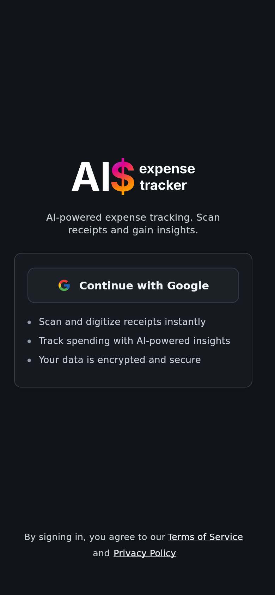
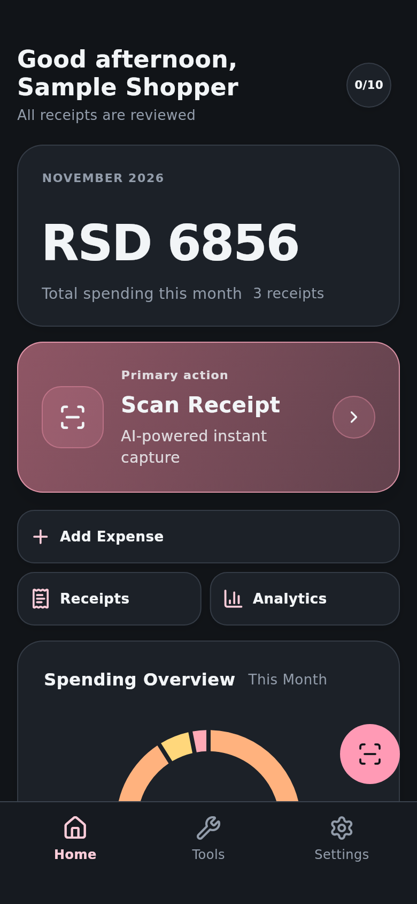
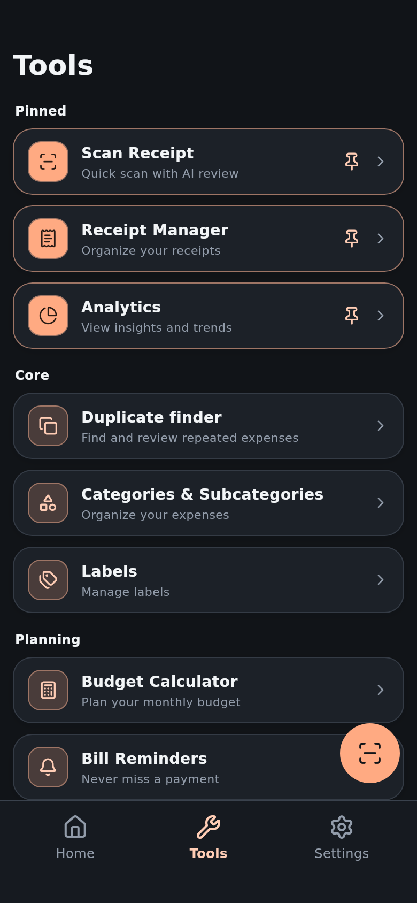
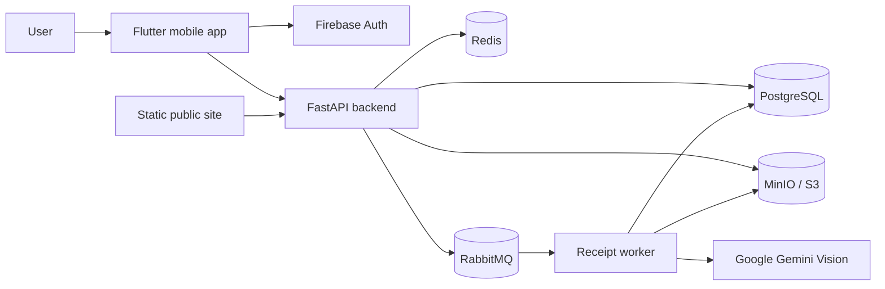
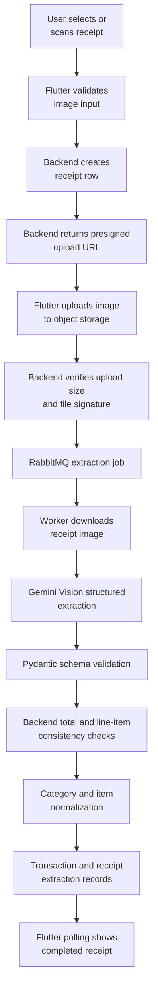

# AI Expense Tracker

AI Expense Tracker is an open-source mobile app for recording expenses,
digitizing receipts, and reviewing spending. It uses Flutter for the app and
FastAPI and Google Gemini for receipt processing.

## Using the app

- Scan or upload a receipt and review the extracted merchant, totals, and line
  items. You can also add an expense manually.
- Find receipts by merchant or item, sort them, and filter amounts in your
  display currency. Organize expenses with categories and labels.
- Compare possible duplicate receipts before deciding which records to keep.
- Use Analytics to see spending by category and compare periods.
- Use **Tools → Export Data** and **Tools → Import Data** to transfer expense
  data using the app's JSON format. **Import Data** also accepts `.mmbackup`
  files from Money Manager by Orange Dog. Review the amounts and currencies
  before you confirm. The importer adds expenses with their dates and
  categories and skips records already imported from the same source.
  The API reads Money Manager backups to prepare the preview in memory.

## App Preview

<p align="center">
  
  
  
</p>

<p align="center"><em>Sign-in, home, and tools shown with sample data</em></p>

## Architecture



## AI Pipeline



## Tech Stack

| Area | Technologies |
|---|---|
| Mobile | Flutter, Dart, Firebase Auth, Google Sign-In, ML Kit document scanner |
| Backend | Python, FastAPI, SQLModel, SQLAlchemy, Alembic, Pydantic |
| AI | Google Gemini Vision, LangChain structured output, optional LangSmith tracing |
| Data | PostgreSQL, Redis, MinIO/S3-compatible object storage |
| Messaging | RabbitMQ, aio-pika |
| Billing | RevenueCat webhooks and entitlement checks |
| Operations | Docker, Docker Compose, Kubernetes, Prometheus, Grafana |
| Quality | Pytest, Ruff, Flutter analyze/test, Gitleaks, Dependabot |

## Installation

### Prerequisites

- Docker and Docker Compose
- Python 3.11+
- `uv`
- Flutter with Dart 3.12 or later in the 3.x release series
- Firebase project for real authentication
- Google AI API key for real receipt extraction

### Local Backend And Services

```bash
cp .env.example .env
mkdir -p backend/.secrets
```

Before starting Compose, place your Firebase Admin service account file at
`backend/.secrets/firebase_sa.json` and set `GOOGLE_API_KEY` in `.env` for receipt
extraction. Use the same Firebase project for the backend and the mobile app.

```bash
docker compose up --build
```

The local public site runs on `http://localhost:3000`.
The backend API runs on `http://localhost:8000`, with interactive API docs at
`http://localhost:8000/docs`.

Run migrations manually when needed:

```bash
docker compose exec backend uv run alembic upgrade head
```

### Backend Without Docker

See the [backend guide](backend/README.md) for running the API locally while
keeping its data services in Docker.

### Flutter App

```bash
cd expense_tracker_app
flutter pub get
flutter run --dart-define=API_BASE_URL=http://10.0.2.2:8000
```

The example configuration uses `10.0.2.2` for the Android emulator. For a
physical phone, pass your development machine's LAN IP in the `API_BASE_URL`
build define. In `.env`, use the same IP for `PUBLIC_API_BASE_URL` and
`S3_EXTERNAL_ENDPOINT`, add it to `TRUSTED_HOSTS`, and restart the Compose
services. See the [Flutter setup guide](expense_tracker_app/README.md) for
Firebase configuration.

## Environment Variables

Copy `.env.example` to `.env` for local development. Never commit real `.env`
files or production secrets.

| Group | Important Variables | Notes |
|---|---|---|
| App | `APP_ENV`, `PUBLIC_API_BASE_URL`, `PUBLIC_APP_BASE_URL`, `TRUSTED_HOSTS`, `CORS_ALLOWED_ORIGINS` | Public URLs and runtime safety boundaries. |
| Database | `DATABASE_URL`, `POSTGRES_HOST`, `POSTGRES_USER`, `POSTGRES_PASSWORD` | Use generated passwords outside local development. |
| Queue/cache | `RABBITMQ_URL`, `RABBITMQ_USER`, `RABBITMQ_PASSWORD`, `REDIS_URL` | RabbitMQ handles async receipt extraction. |
| Storage | `S3_ENDPOINT`, `S3_EXTERNAL_ENDPOINT`, `S3_ACCESS_KEY`, `S3_SECRET_KEY`, `S3_BUCKET_RECEIPTS` | Presigned uploads and receipt retrieval. |
| Auth | `FIREBASE_SERVICE_ACCOUNT_PATH`, `FIREBASE_SERVICE_ACCOUNT_JSON_B64` | Server-side Firebase token verification. |
| AI | `GOOGLE_API_KEY`, `LLM_MODEL_NAME`, `ITEM_NORMALIZATION_ENABLED` | Required for real Gemini extraction. |
| Billing | `REVENUECAT_SECRET_API_KEY`, `REVENUECAT_WEBHOOK_AUTH_SECRET`, `REVENUECAT_*_ENTITLEMENT_ID` | Keep server keys secret. |
| Mobile build | `API_BASE_URL`, `REVENUECAT_ANDROID_API_KEY`, `APP_PRIVACY_URL`, `APP_TERMS_URL` | Passed with `--dart-define` for production builds. |

Full details are in [docs/ENVIRONMENT_VARIABLES.md](docs/ENVIRONMENT_VARIABLES.md).

## Deployment

### Docker

Build the backend image from the repository root:

```bash
docker build -f Dockerfile -t ai-expense-tracker-backend:local .
```

Build the public site:

```bash
docker build -f site/Dockerfile -t ai-expense-tracker-site:local .
```

For a single host behind a reverse proxy, the production Compose override
publishes ports on loopback. Use Docker Compose 2.24.4 or later and configure
production credentials, public URLs, and trusted hosts in `.env` before
starting the services.

```bash
docker compose -f docker-compose.yaml -f docker-compose.prod.yaml up -d
```

### Kubernetes

Production manifests live under `infra/k8s`. The production overlay is rendered
from environment input and validated in CI:

```bash
uv run python infra/k8s/scripts/render_k8s_env.py \
  --env-file .env.production.example \
  --output-dir infra/k8s/overlays/production/generated

kubectl kustomize infra/k8s/overlays/production
```

See [docs/DEPLOYMENT.md](docs/DEPLOYMENT.md) and [docs/OPS_RUNBOOK.md](docs/OPS_RUNBOOK.md) for operational details.

## Testing

Backend:

```bash
cd backend
uv run ruff check .
uv run pytest -q
```

Flutter:

```bash
cd expense_tracker_app
flutter analyze
flutter test
```

Security:

```bash
gitleaks detect --source . --config .gitleaks.toml --redact --verbose
```

## Engineering Decisions

- Firebase Auth is used to avoid building custom credential storage and token
  lifecycle management.
- Receipt images are uploaded directly to object storage through presigned URLs
  so the API does not proxy large files.
- RabbitMQ separates user-facing upload latency from slower AI extraction.
- Gemini Vision is used for receipt OCR-like understanding and structured
  extraction from messy layouts.
- Backend validation computes deterministic warnings instead of trusting the LLM
  to identify all inconsistencies.
- S3-compatible storage keeps the system portable between local MinIO and cloud
  object stores.
- Kubernetes network policies and startup checks make production assumptions
  explicit.

More detail is available in [DESIGN.md](DESIGN.md).

## Contributing and security

See [CONTRIBUTING.md](CONTRIBUTING.md) for development and pull request guidance
and [SECURITY.md](SECURITY.md) for vulnerability reporting. The project is
licensed under the [MIT License](LICENSE). See the
[third-party notices](THIRD_PARTY_NOTICES.md) for dependency and asset licenses.
